# -Nop-bai-tap-6.3_6.4_6.5---MSSV-24810340318---Ngo-Gia-Thanh-
MỤC 1: THÔNG TIN SINH VIÊN
- Họ và tên sinh viên: [Ngô Gia Thành]
- Mã sinh viên: [24810340318]
- Lớp / Khóa: [D19QTANM1]

MỤC 2: HÌNH ẢNH KẾT QUẢ CÁC MÀN HÌNH CHỨC NĂNG

ẢNH BÀI 6.3
1. Màn hình Chính / Tổng quan hệ thống: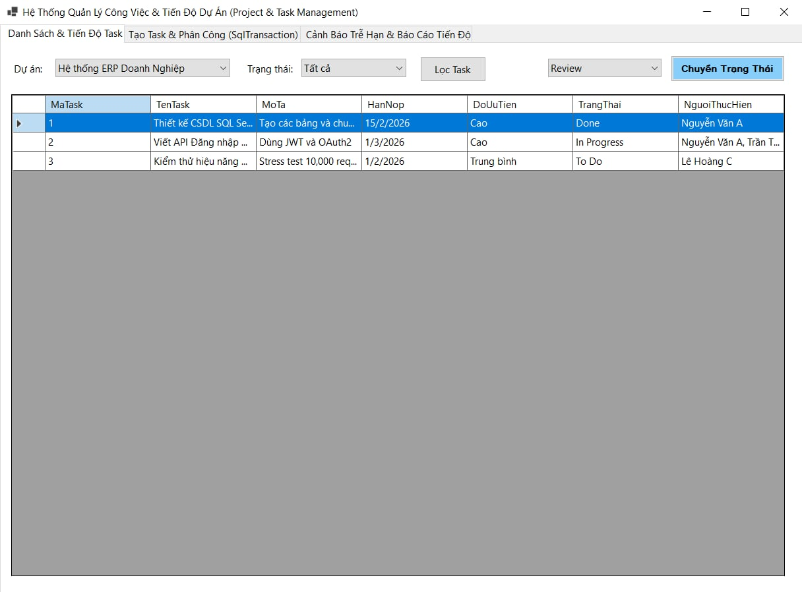
2. Màn hình Quản lý Danh mục (CRUD - Thêm/Sửa/Xóa):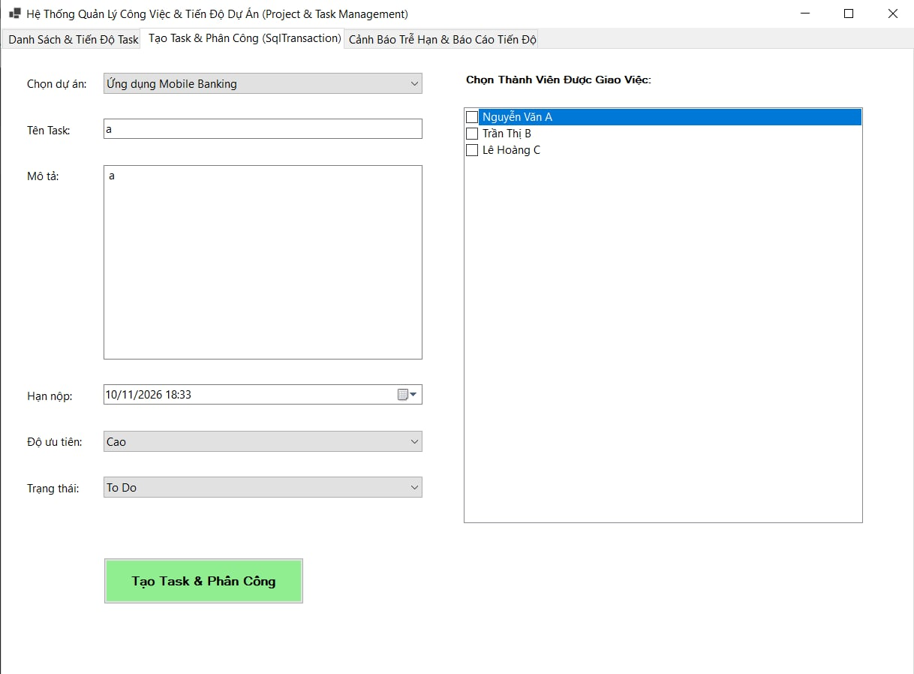
3. Màn hình Thực thi Nghiệp vụ chính (Lập Hóa đơn / Bán hàng / Chấm công / Đặt phòng):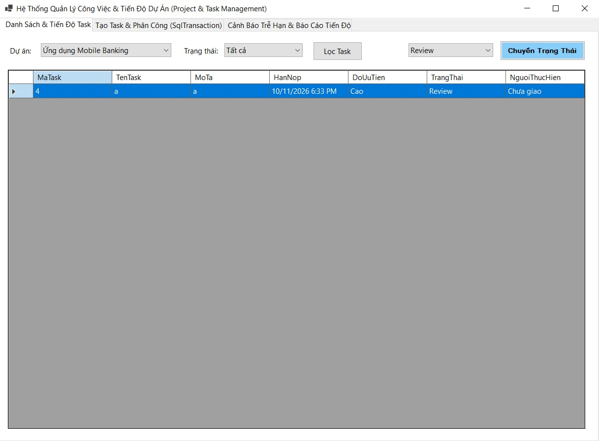
4. Màn hình Báo cáo - Thống kê: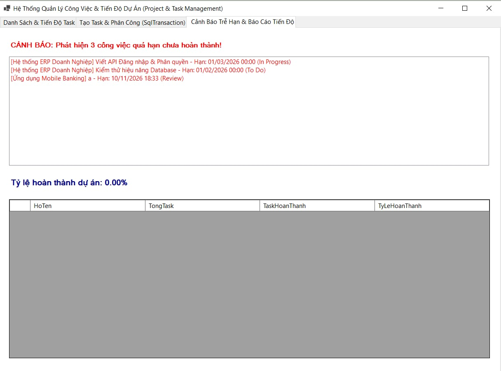
5. Minh họa An toàn Dữ liệu (Phòng chống SQL Injection / Báo lỗi Transaction Rollback):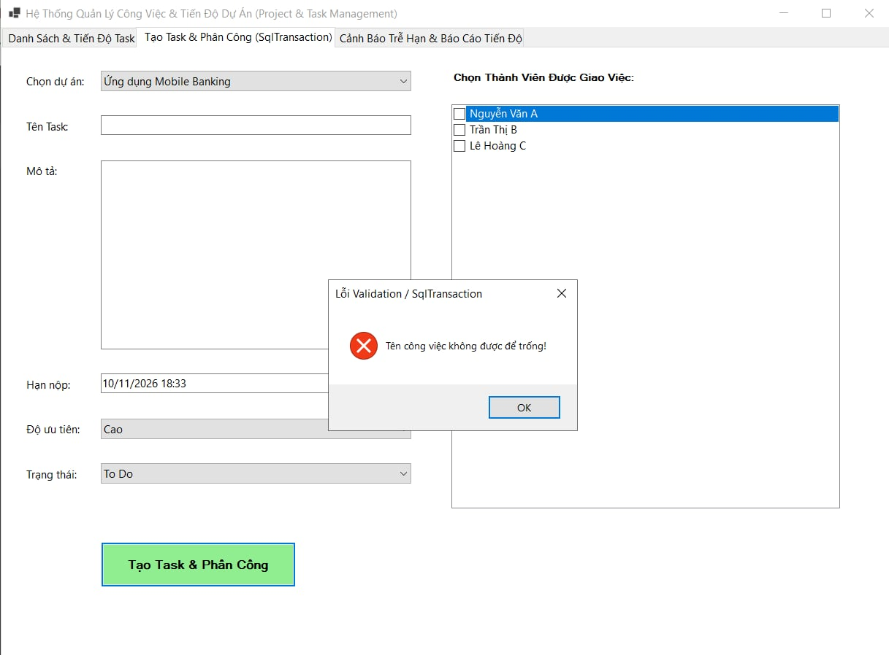

ẢNH BÀI 6.4
1. Màn hình Chính / Tổng quan hệ thống: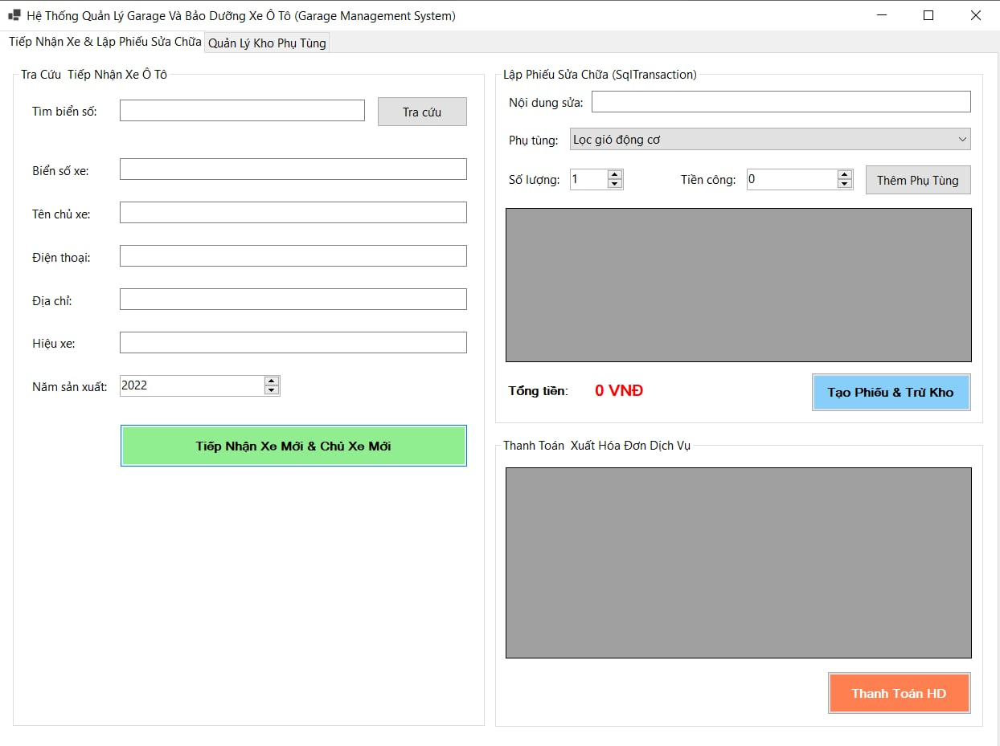
2. Màn hình Quản lý Danh mục (CRUD - Thêm/Sửa/Xóa):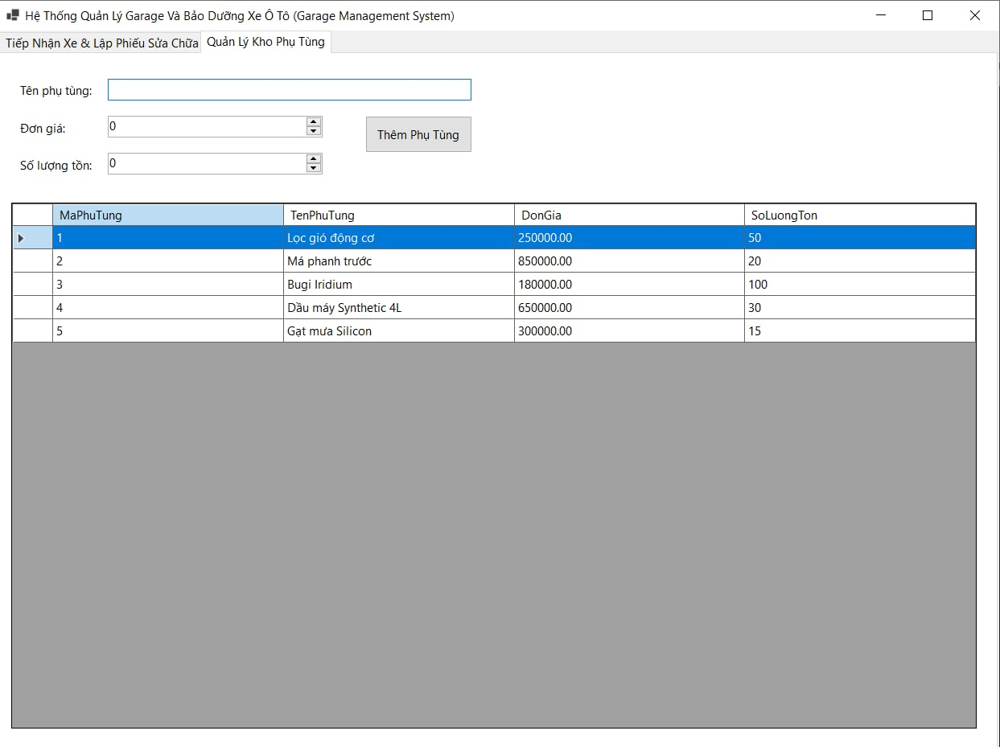
3. Màn hình Thực thi Nghiệp vụ chính (Lập Hóa đơn / Bán hàng / Chấm công / Đặt phòng):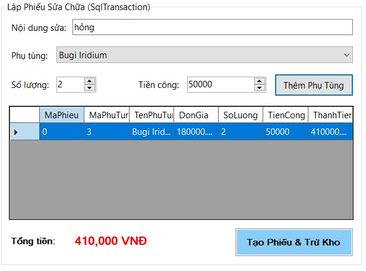
4. Màn hình Báo cáo - Thống kê: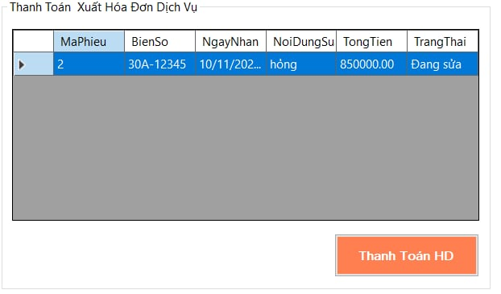
5. Minh họa An toàn Dữ liệu (Phòng chống SQL Injection / Báo lỗi Transaction Rollback):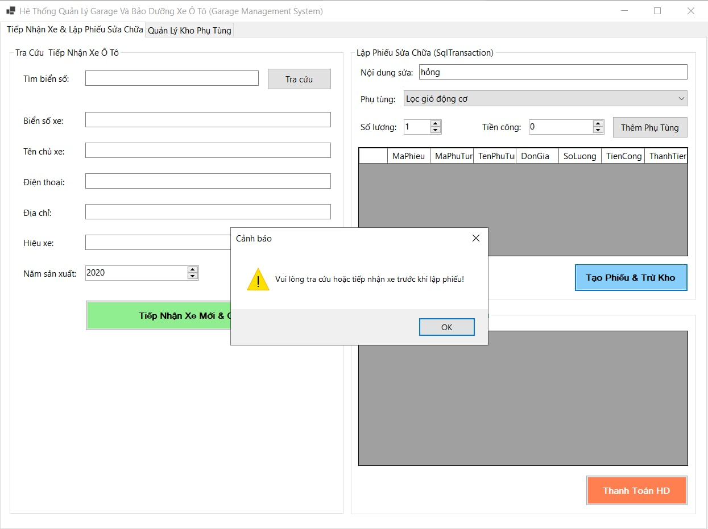

ẢNH BÀI 6.5
1. Màn hình Chính / Tổng quan hệ thống: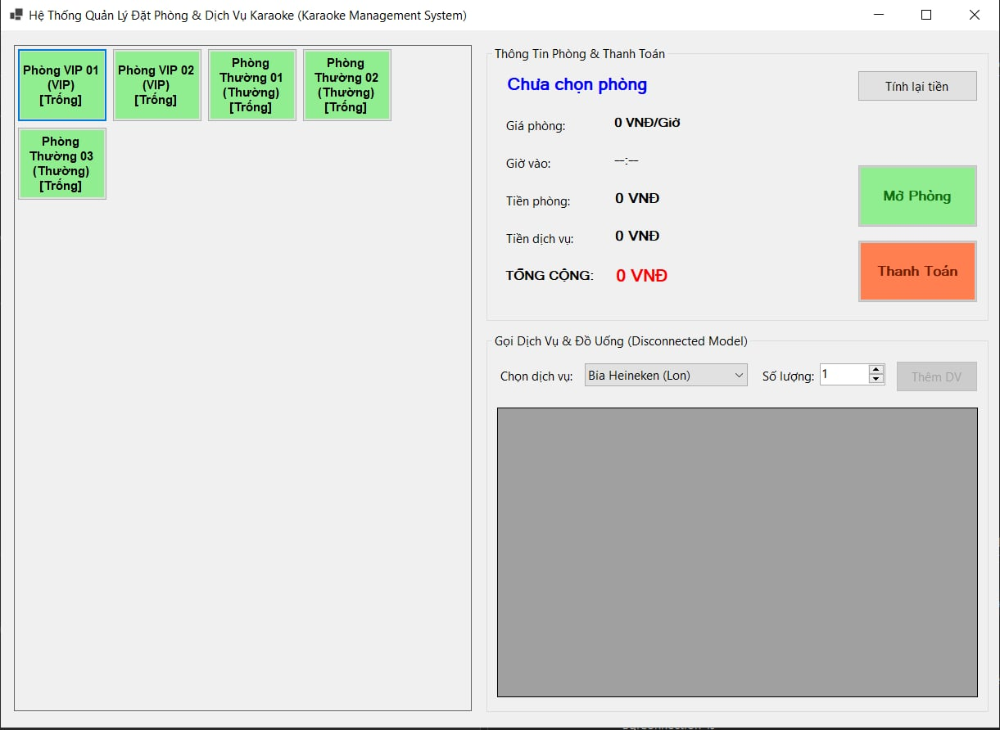
2. Màn hình Quản lý Danh mục (CRUD - Thêm/Sửa/Xóa):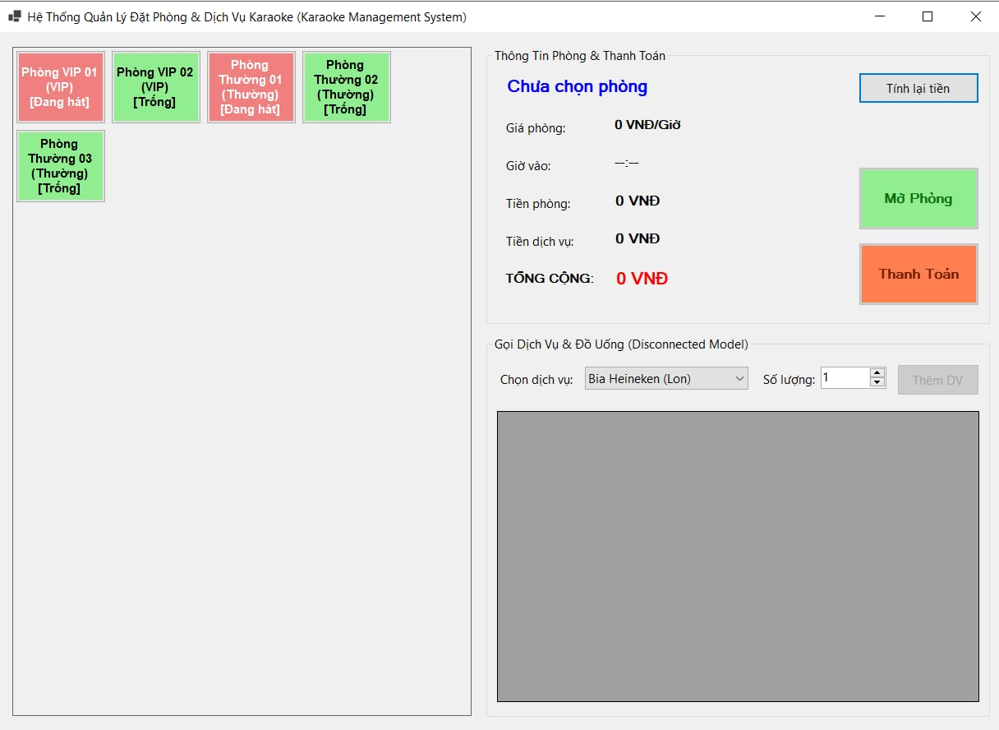
3. Màn hình Thực thi Nghiệp vụ chính (Lập Hóa đơn / Bán hàng / Chấm công / Đặt phòng):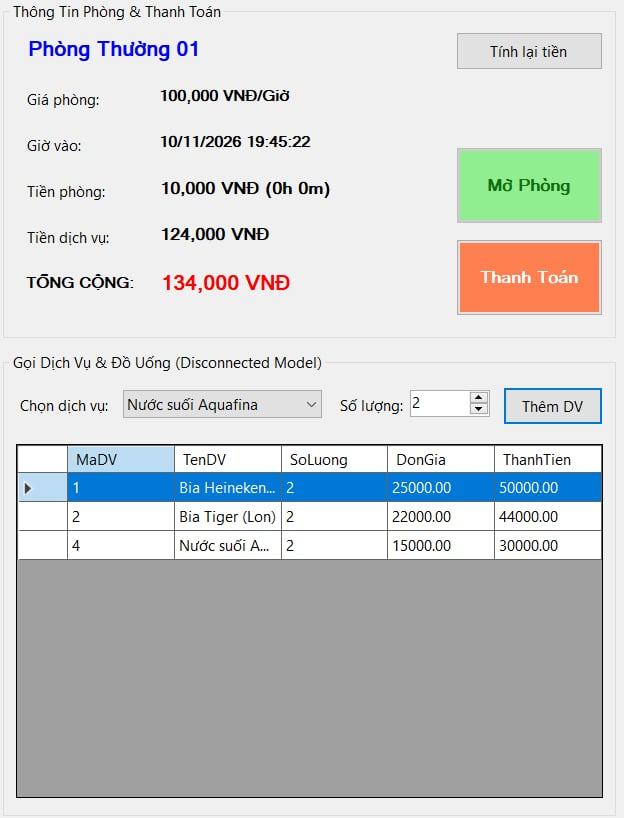
4. Màn hình Báo cáo - Thống kê: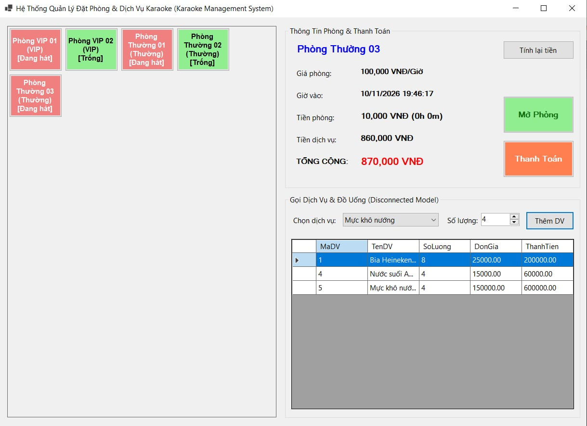
